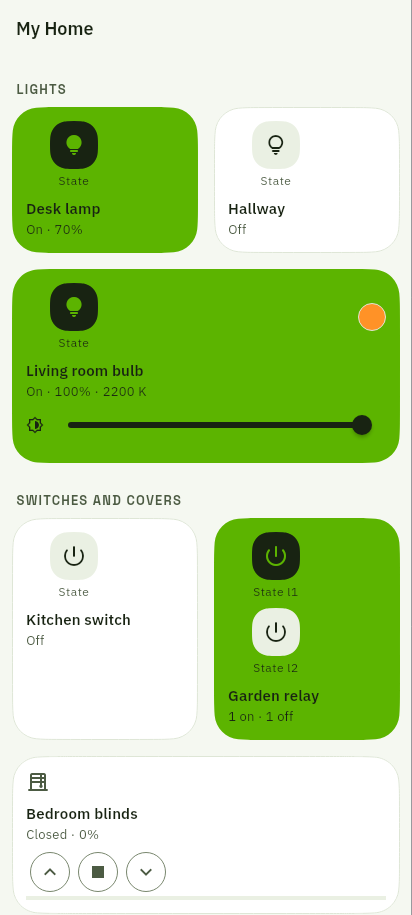
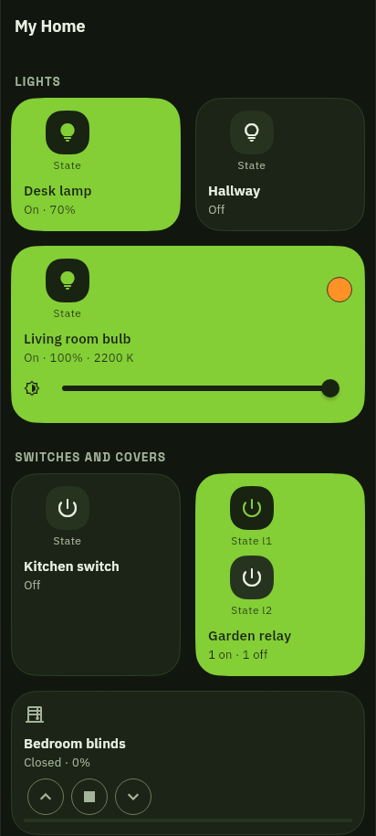
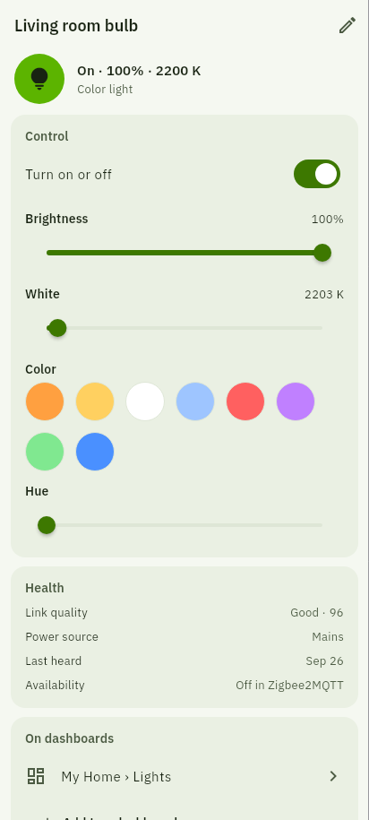
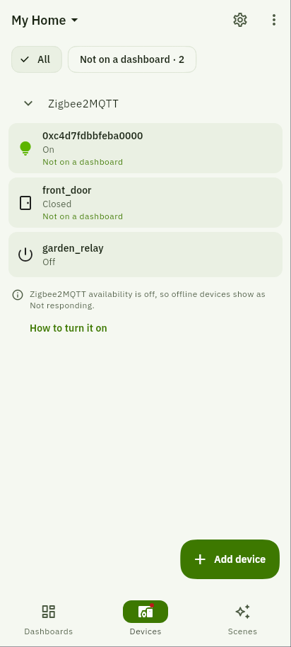
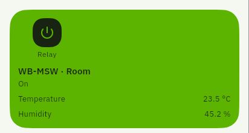

# WireDash

**An Android MQTT dashboard for Wiren Board, Zigbee2MQTT and custom MQTT devices, with embedded WireGuard.**

WireDash is a fork of [ZigDash](https://github.com/giladtamam/zigdash), created by
[Gilad Tamam](https://github.com/giladtamam). It keeps the original MIT license
and builds on its MQTT dashboards, device controls, scenes and tablet layouts.

[](LICENSE)
[](https://github.com/VadimSurpin/WireDash/actions)
[](https://flutter.dev)

Connect directly to your existing MQTT broker. WireDash does not require its
own server, cloud account or dashboard backend. Optional hub-side ZigDash Engine and Node-RED flows provide automation,
recording and alerts when the phone is offline. The upstream encrypted relay
is an optional, separately configured remote-access service; embedded
WireGuard does not use it.

<p align="center">
  
  
  
  
</p>

These are rendered views of the actual app widgets with demo devices and values.
See [screenshot sources and regeneration](docs/screenshots/README.md).

## Changes in this fork

- **[Embedded WireGuard](docs/EMBEDDED_WIREGUARD.md)** — import a peer configuration
  in the initial connection form or a home's settings. MQTT TCP, TLS, WebSocket
  and WSS can use the app's own tunnel, without a separate VPN app or system VPN
  permission. Configurations are encrypted on the device. Tunnel failures do not
  silently switch the broker connection to a direct route.
- **[Wiren Board discovery](docs/WIRENBOARD_DISCOVERY.md)** — discover devices and
  controls from retained `/devices/…` MQTT metadata. Add a whole device as one
  dashboard panel, or choose an individual property and its widget. Non-built-in
  devices are added automatically after discovery.
- **Organized device lists** — expand a device inline to browse its properties.
  Collapsible sections separate controller built-ins, added modules and WB
  mirrors of Zigbee2MQTT devices. All categories start collapsed in both All devices and Add tile. Both views
  share the full device list, with matching backgrounds for WB and Z2M rows.
  Built-ins include cloud status, network connections, KNX gateway, battery and
  alarms.
- **Compact panels and icons** — dashboard rows follow their contents. Switch
  tiles wrap the control below the icon and label on narrow screens. Choose
  icons in the panel editor, including separate on/off icons for switches.
- **Panel-specific controls and labels** — whole-device WB panels use the same
  style as Zigbee2MQTT panels. In the panel editor, choose visible properties and
  give them custom labels. Single properties offer a widget selector. **Allow
  commands** can explicitly enable editable widgets when metadata incorrectly
  marks a writable control read-only.
- **[Before-display JavaScript expressions](docs/DISPLAY_EXPRESSIONS.md)** — format
  each field before rendering, for example `Number(value).toFixed(2)` or
  `(Number(value) / 1000).toFixed(2)`. Test expressions in the editor. Formatting
  settings belong to each panel; commands keep their raw values.
- **[Wiren Board green theme](docs/WIRENBOARD_THEME.md)** — green device states,
  buttons and accents, matching light/dark surfaces, a new launcher icon and a
  matching startup splash. The Material You option remains available.
- **[No telemetry](docs/PRIVACY.md)** — the analytics SDK, event hooks, consent
  prompts, feature-request entry and roadmap poll are removed. Old queued usage
  records are cleared on upgrade. Manual help and problem-report actions remain
  user-initiated and open editable issue drafts in this repository. The bundled
  manual stays local; project, setup-guide and release links target WireDash.
  No reports are submitted automatically.
- **Localized UI** — 13 languages: English, Czech, Dutch, French, German, Hebrew,
  Italian, Norwegian Bokmål, Polish, Portuguese, Russian, Spanish and Swedish,
  including RTL layouts.

<p align="center">
  
</p>

## Dashboard features

This branch also includes an **[Android Auto IoT preview](docs/ANDROID_AUTO.md)**
for dashboard switches, command buttons and gate/roller controls, using the
configured MQTT/WireGuard connection. On current Android Auto hosts, saved
groups and their buttons appear directly in a scrolling dashboard with no
control-detail step or Next/Previous pages. Real-car installation requires a trusted
Google Play test install; the documentation includes Desktop Head Unit testing.

WireDash also retains the original project's Zigbee2MQTT auto-discovery,
custom MQTT topics, JSON-path extraction, switches, sliders, covers, readings,
gauges, text controls, scenes, schedules and auto-close rules. It supports
multiple brokers, automatic reconnect, dashboard sections, per-panel editing
and JSON backup/restore.

After returning from the background, WireDash rebuilds the MQTT session through
the configured transport, including WireGuard, and restores active state
subscriptions. The dashboard shows its connection banner while reconnecting;
commands are not replayed.

For wall tablets, use fullscreen, dimming, a PIN-protected kiosk, a clock with
readings, motion wake-up and on-screen alarms. Android shortcuts include Quick
Settings tiles, Device Controls and home-screen widgets. Optional Node-RED
flows provide longer history and hub-side automation. The `foss` build exposes
all app features without Play billing.

## Install

Download the APK for your phone from [WireDash releases](https://github.com/VadimSurpin/WireDash/releases/latest):
`arm64-v8a` for most current phones, `armeabi-v7a` for older 32-bit devices, or
`x86_64` for compatible emulators. Releases include SHA-256 checksums. Android
7.0 or newer is required. These are release-mode FOSS builds with all app
features unlocked and no Play billing.

The first WireDash release uses the same local development signing certificate
as the previously supplied WireDash test APKs, allowing in-place updates.
Keep that certificate stable when building updates. This is not the upstream
ZigDash Play signing key.

The default branch, `main`, contains the accepted Android Auto implementation,
embedded WireGuard, Wiren Board support, custom controls, the green theme and
telemetry removal. It includes upstream ZigDash 3.2.0 (`a1da985`).

See [upstream integration](docs/UPSTREAM.md) for the branch and merge workflow.
Historical feature branches remain as references; new work starts from `main`.

## Build and test

Use the Flutter version in [.fvmrc](.fvmrc). `tool/flutter` selects it through
FVM or `ZIGDASH_FLUTTER`. Android builds also need Java 17, the Android SDK/NDK
and Go 1.26+ on `PATH`; see the [WireGuard build notes](docs/EMBEDDED_WIREGUARD.md#build-and-check).
Linux tests for display expressions additionally need CMake and a C/C++ compiler.

```bash
git clone https://github.com/VadimSurpin/WireDash.git
cd WireDash
tool/flutter pub get
tool/flutter pub run build_runner build --delete-conflicting-outputs
python3 tool/build_display_js_native.py
export JSF_LIBRARY_PATH="$PWD/.dart_tool/display-js-native/libjsf.so"
tool/flutter analyze
tool/flutter test
```

Build the ARM64 Android test APK:

```bash
tool/flutter build apk --debug --flavor foss --split-per-abi --target-platform android-arm64
```

For release APKs:

```bash
tool/flutter build apk --release --flavor foss --split-per-abi \
  --no-tree-shake-icons --dart-define=ZIGDASH_FLAVOR=foss
```

Signing uses `android/key.properties` (gitignored). Keep your signing key stable
for updates. WireDash uses Android application ID and namespace
`pro.surpin.wiredash`, and Dart package name `wiredash`. It installs alongside
the original ZigDash app, with separate settings, widgets and storage.

Earlier WireDash development APKs used ZigDash's application ID. Re-create
the connection in WireDash and import a dashboard backup exported from the
earlier app. Android does not transfer settings or widgets between application
IDs, and dashboard backups do not include connection credentials.

Home Assistant browser sign-in still uses the registered upstream OAuth return
link. If Android asks which app should handle that link, select WireDash.

## Help and upstream credits

For issues specific to this fork, use the [WireDash issue tracker](https://github.com/VadimSurpin/WireDash/issues).
The bundled Help & Guide opens locally. Get help and Report a problem open
editable GitHub issue drafts in this repository only after you choose them.
Review the included support details before posting a public issue. Project
and Releases actions also point here; no inherited email or Telegram action
contacts the original author.

The original project remains available here:

- [ZigDash source](https://github.com/giladtamam/zigdash) and [original README](https://github.com/giladtamam/zigdash#readme)
- [Original ZigDash on Google Play](https://play.google.com/store/apps/details?id=com.giladtamam.zigdash)
- [ZigDash website](https://zigdash.app) and [community](https://t.me/zigdash_app)
- [Support the original author](https://github.com/sponsors/giladtamam)

## License

[MIT](LICENSE). Original ZigDash code © 2026 Gilad Tamam.
The original license and copyright notice are preserved in this fork.
